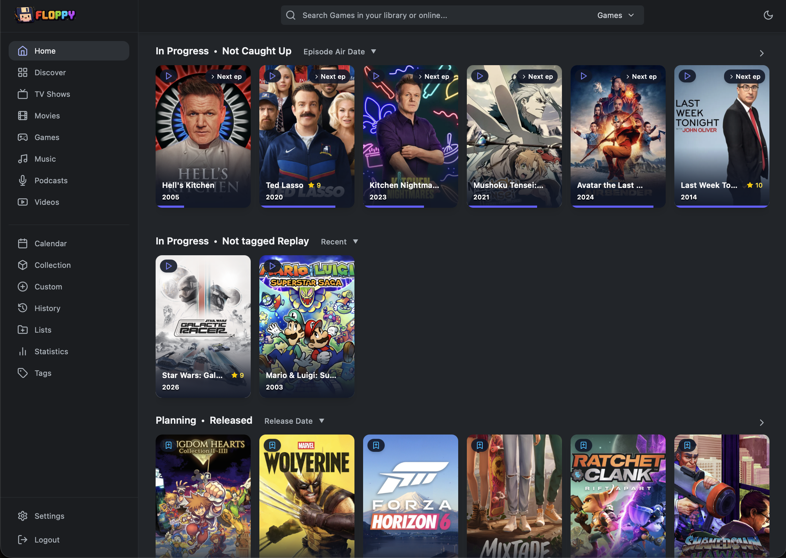
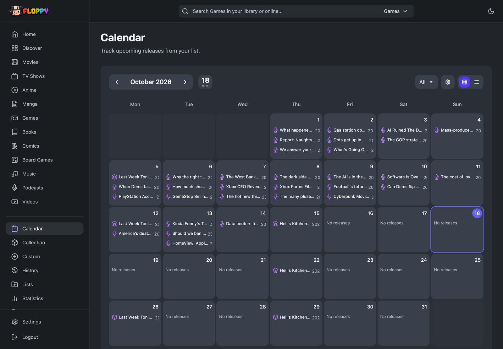
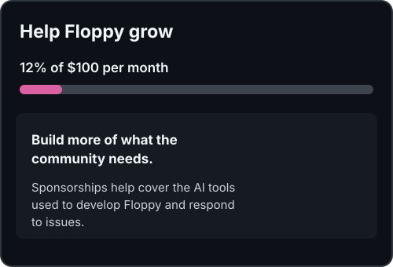

<p align="center">
  
</p>

<p align="center">
  <b>Your own private Trakt, Letterboxd, and Goodreads — in one app, on your own hardware.</b><br>
  Track movies, TV, anime, books, comics, manga, games, board games, music, and podcasts in one place.
</p>

<p align="center">
  <a href="https://yamtrack.dannyvfilms.com">Live demo</a> ·
  <a href="#install">Install</a> ·
  <a href="https://github.com/dannyvfilms/Floppy/wiki">Docs</a> ·
  <a href="https://discord.gg/uFgha7Kb6n">Discord</a> ·
  <a href="https://github.com/dannyvfilms/Floppy/releases">Releases</a> ·
  <a href="https://github.com/sponsors/dannyvfilms?metadata_source=readme">Sponsor</a>
</p>

Floppy is a self-hosted media tracker and diary for everything you watch, read,
play, and listen to. Log
what you finish, see what to pick up next, and get a yearly recap of how you spent
your time. Connect Plex, Jellyfin, Emby, Pocket Casts, or Last.fm and your history
fills itself in.

It is free and open source. You run it on a computer or server at
home and open it from any browser, on desktop or phone. Your data never leaves
your machine unless you connect a service that needs it.

<p align="center">
  
</p>

## A look around

<table>
  <tr>
    <td width="50%" valign="top">
      <br>
      <b>Home</b> — what you're in the middle of, what's next, and rows you choose.
    </td>
    <td width="50%" valign="top">
      <br>
      <b>Statistics</b> — a recap of your year, by media type, day, and hour.
    </td>
  </tr>
  <tr>
    <td valign="top">
      <br>
      <b>Lists</b> — private, public, or smart lists that fill themselves.
    </td>
    <td valign="top">
      <br>
      <b>Collection</b> — what you own, down to the format and resolution.
    </td>
  </tr>
  <tr>
    <td valign="top">
      <br>
      <b>Calendar</b> — upcoming episodes and releases for everything you track.
    </td>
    <td valign="top">
      <br>
      <b>On your phone</b> — built for mobile, and installable as an app.
    </td>
  </tr>
</table>

Light and dark themes follow your device; switch with the moon icon or under
**Settings → Appearance**.

## What it does

- **One library for every kind of media.** Movies and TV through to music
  albums, podcast episodes, board games, and comics — each with pages, progress,
  and ratings that fit it.
- **Knows what's next.** In-progress shows show the next episode and time
  left; the calendar and optional notifications tell you when new ones arrive.
- **History that fills itself in.** Plays from Plex, Jellyfin, Emby, Pocket
  Casts, and Last.fm are logged automatically. Manual check-ins take one tap.
- **Recaps worth reading.** Hours by media type, streaks, top people, and
  year-over-year comparisons.
- **Lists you can share.** Public pages, RSS feeds, and smart lists built
  from rules.
- **Your collection, too.** Track physical and digital copies alongside what
  you've watched or read, with Plex collection sync.
- **Recommendations from your own taste.** Discover rows learn from what you
  rate and finish, and you can send requests to Seerr in one click.
- **Bring your history with you.** Import from Trakt, TV Time, Simkl, IMDb,
  MyAnimeList, AniList, Goodreads, StoryGraph, Steam, PlayStation, Xbox, and
  more. Export
  everything to CSV at any time.

The [full feature tour](https://github.com/dannyvfilms/Floppy/wiki/Features) on
the wiki lists everything, including multi-user accounts, OIDC sign-in, a REST
API, and an MCP server.

## Try it

The [live demo](https://yamtrack.dannyvfilms.com) is open — sign in with
username `demo` and password `demodemo`. It's one shared account, so what
you add is visible to everyone else trying it.

## Install

Floppy runs on a computer or server you leave on. You open it from any browser
on your network. One guided installer covers the common setups. Paste the
same line on Windows, macOS, or Linux; it selects the right installer.

| Your system | What the installer does |
| --- | --- |
| Windows 10 and 11 | Uses Docker Desktop and offers to install it for you |
| macOS | Uses Docker Desktop, or a native Homebrew install |
| Ubuntu and Debian | Installs Docker for you, or runs natively with systemd |
| Other Linux | Needs Docker already installed |

The installer asks a few plain questions and asks before it installs anything.
It never asks for a password or API key. It finishes with Floppy open in your
browser.

Open **PowerShell** on Windows or **Terminal** on macOS/Linux. Paste this entire
line and press Enter:

```text
echo "\" | Out-Null; irm 'https://raw.githubusercontent.com/dannyvfilms/Floppy/latest/scripts/install.ps1' -ErrorAction Stop | iex; #" >/dev/null; bash -c 'p=$(mktemp) || exit; cleanup() { rm -f "$p"; }; trap cleanup EXIT; curl -fsSL https://raw.githubusercontent.com/dannyvfilms/Floppy/latest/scripts/install.sh -o "$p" && bash "$p"'
```

### Phones and tablets

Once Floppy is running, open it in your phone's browser and add it to your
home screen. [Step-by-step guide](https://github.com/dannyvfilms/Floppy/wiki/2.-User-Guide#installing-floppy-on-your-phone).

### If you know what you're doing

- [Docker Compose](docs/deployment.md#docker-compose-recommended) works for
  Unraid, Synology and Portainer too. `SECRET` is the only setting you must fill in.
- [Docker Run](docs/deployment.md#docker-run) if you don't use Compose.
- [Deployment reference](docs/deployment.md) covers PostgreSQL, reverse proxies,
  environment variables, upgrades and troubleshooting.
- [What the installer does](docs/install.md), step by step.

## Privacy and trust

Your library, ratings, and activity stay in the database you run. Floppy has no
analytics and no central update check. It does contact metadata providers (such
as TMDB) to look up titles and artwork, and connected services receive what their
features need. Run it for yourself or people you trust, and turn off sign-ups
after creating your account. Details:
[security notes](docs/security-hardening.md) ·
[reporting a vulnerability](SECURITY.md).

## Coming from Yamtrack?

Floppy started as a fork of [Yamtrack](https://github.com/FuzzyGrim/Yamtrack).
Yamtrack CSV exports import directly under **Settings → Import**, and existing
containers of this project keep working after the rename — just move to the
`ghcr.io/dannyvfilms/floppy` image. [Migration notes](https://github.com/dannyvfilms/Floppy/wiki#coming-from-yamtrack).

## Building on Floppy

Floppy has a REST API at `/api/v1` and an [MCP server](mcp_server/) for AI
assistants. Start with the
[API and MCP guide](https://github.com/dannyvfilms/Floppy/wiki/7.-API-and-MCP-Server);
your running instance serves its own API index at `/api/docs/`. Download tools
can read lists and report owned media ([FlexGet guide](docs/integrations/flexget.md)).

## Community and support

<table>
  <tr>
    <td width="50%" valign="top">
      <ul>
        <li><b>Questions and ideas:</b> <a href="https://discord.gg/uFgha7Kb6n">Discord</a> is the place to share setups and help each other out.</li>
        <li><b>Bugs and feature requests:</b> <a href="https://github.com/dannyvfilms/Floppy/issues">open an issue</a>.</li>
        <li><b>Contributing:</b> code, docs, and polish are welcome — see the <a href="CONTRIBUTING.md">contributing guide</a>.</li>
        <li><b>Sponsoring:</b> <a href="https://github.com/sponsors/dannyvfilms">support Floppy on GitHub Sponsors</a>.</li>
        <li><b>Starring</b> the repository helps more people find it.</li>
        <li><i>The card refreshes daily from GitHub Sponsors public data.</i></li>
      </ul>
    </td>
    <td width="50%" align="center" valign="middle">
      <a href="https://github.com/sponsors/dannyvfilms">
        
      </a>
    </td>
  </tr>
</table>

<hr>

<p align="center">
  Thank you to everyone who has contributed to Floppy and to Yamtrack before it.<br><br>
</p>

<p align="center">
  <a href="https://github.com/dannyvfilms/Floppy/graphs/contributors">
    
  </a>
</p>

## Configuration and deployment

The full operator reference moved to [docs/deployment.md](docs/deployment.md).
Links into the old sections of this page land here:

<a name="floppy-cant-reach-redis"></a><a name="sqlite-data-paths"></a><a name="postgresql"></a><a name="environment-variables"></a><a name="running-on-a-small-host"></a><a name="upgrading-container-images"></a><a name="verifying-a-published-image-actually-has-a-fix"></a><a name="reverse-proxy-setup"></a><a name="docker-image-tags"></a>

- [Docker Compose example](docs/deployment.md#docker-compose-recommended) ·
  [Docker Run](docs/deployment.md#docker-run) ·
  [Portainer and Unraid](docs/deployment.md#portainer-and-unraid)
- [SQLite data paths](docs/deployment.md#sqlite-data-paths) ·
  [PostgreSQL](docs/deployment.md#postgresql) ·
  [Persistence checklist](docs/deployment.md#persistence-checklist)
- [Environment variables](docs/deployment.md#environment-variables) ·
  [Running on a small host](docs/deployment.md#running-on-a-small-host) ·
  [Reverse proxy setup](docs/deployment.md#reverse-proxy-setup)
- [Floppy can't reach Redis](docs/deployment.md#floppy-cant-reach-redis) ·
  [Startup diagnostics](docs/deployment.md#startup-diagnostics) ·
  [I updated and my login is gone](docs/deployment.md#troubleshooting-i-updated-and-my-login-is-gone)
- [Upgrading container images](docs/deployment.md#upgrading-container-images) ·
  [Verifying a published image](docs/deployment.md#verifying-a-published-image-actually-has-a-fix) ·
  [Docker image tags](docs/deployment.md#docker-image-tags)
- Developing locally: [contributing guide](CONTRIBUTING.md#local-development)

## License

AGPL-3.0.

## Origins and AI use

Floppy began as a fork of [FuzzyGrim/Yamtrack](https://github.com/FuzzyGrim/Yamtrack)
and still shares its foundation and data model; this repository keeps the fork
link. It has since grown into its own project. Thanks to FuzzyGrim and Yamtrack's
contributors for the groundwork.

Floppy uses AI coding agents for implementation, tests, and documentation under
maintainer direction. This describes Floppy's development, not all inherited
Yamtrack history. PRs should disclose the model/workflow used and record human
review only when it actually occurred. Agent reviews and passing checks are
not independent security certification.
